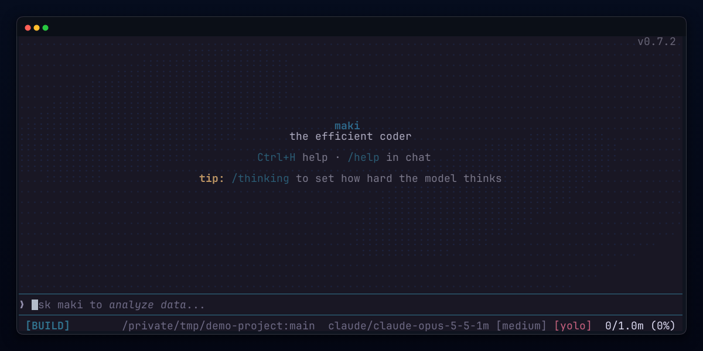

# maki-path-completion

<kbd>Tab</kbd> path completion for [maki](https://maki.sh). Press <kbd>Tab</kbd> after a partial
path in the chat input and a popup opens on the caret, listing matching files and directories ranked
by fuzzy match.



## Install

Add the package to `~/.config/maki/init.lua`:

```lua
maki.pack.add({ "https://github.com/kdheepak/maki-path-completion" })
```

On the next start maki asks to install it, and to grant the permissions listed in `plugin.toml`:

| Permission      | Used for                                                      |
| --------------- | ------------------------------------------------------------- |
| `fs_read`       | Listing directories, and accepting maki's own file completion |
| `session_read`  | Reading the session's working directory and the input draft   |
| `input`         | Writing the chosen path into the chat input                   |
| `agent`         | Changing the input's text, which Enter then sends             |
| `session_write` | Changing the input's text, which Enter then sends             |

## Usage

| Key                                   | Action                          |
| ------------------------------------- | ------------------------------- |
| <kbd>Tab</kbd>                        | Complete the path at the cursor |
| <kbd>Tab</kbd> / <kbd>Enter</kbd>     | Insert the selected path        |
| <kbd>↑</kbd> / <kbd>↓</kbd>           | Move the selection              |
| <kbd>Ctrl-p</kbd> / <kbd>Ctrl-n</kbd> | Move the selection              |
| <kbd>Esc</kbd>                        | Close the popup                 |

- Relative paths resolve against the session's working directory.
- Words starting with `@`, `$` or `!` are left to maki's own completers.
- With no word to complete, <kbd>Tab</kbd> still switches between plan and build.

## Custom keys

To bind the key yourself, load the package with `key = false` and call the `complete` action:

```lua
maki.pack.add({ "https://github.com/kdheepak/maki-path-completion" }, {
  load = function()
    require("maki_path_completion").setup({ key = false })
  end,
})

maki.keymap.set("i", "<Tab>", function(ev)
  if maki.ui.action("completion.accept") then return end
  if maki.ui.action("maki-path-completion.complete") then return end
  ev.fallback()
end)
```

Or pass another key, like `setup({ key = "<M-p>" })`. Calling the action needs `fs_read`, `input`,
`session_read`, `agent` and `session_write` in `~/.config/maki/plugin.toml`.
